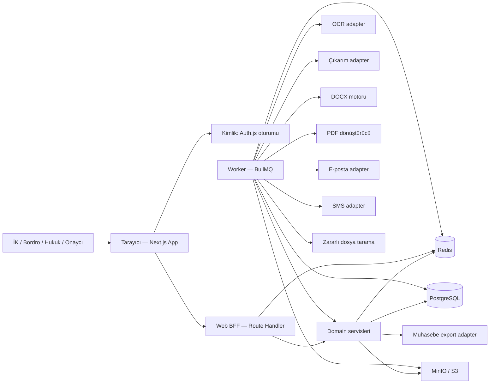
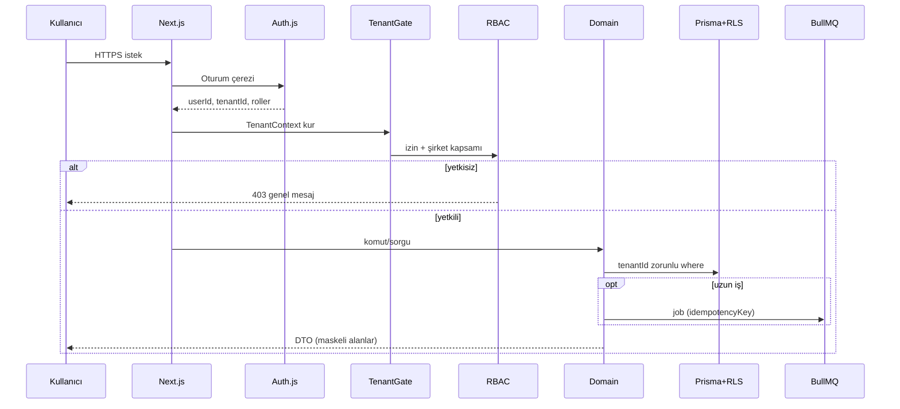

# Sistem Mimarisi

**Ürün:** İcra360 (`icra360` / `@icra360`). Marka: [brand.md](./brand.md).

**İlgili belgeler:** [requirements.md](./requirements.md) · [data-model.md](./data-model.md) · [api-design.md](./api-design.md) · [security.md](./security.md)

Bu belge uygulama kodu değildir. Hedef mimariyi, sınırları ve seçilen teknik kararları kaydeder.

---

## 1. Mimari ilkeler

1. **Domain UI’dan ayrıdır.** Next.js sayfaları ve route handler’lar ince kalır; iş kuralları `packages/domain` içindedir.
2. **Tenant filtresi atlanması zor bir kapıdan geçer.** Her sorgu `TenantContext` olmadan repository’ye inemez. PostgreSQL RLS ikinci hattır.
3. **Onaysız yan etki yoktur.** Cevap yazısı gönderimi, sıra kesinleştirme, dönem kilidi, dosya kapatma kullanıcı kararıdır.
4. **Sağlayıcı kilitlenmesi yok.** OCR, çıkarım, depolama, virüs, e-posta, SMS, PDF, muhasebe dışa aktarma adapter arayüzüdür.
5. **Uzun işler istek içinde yapılmaz.** OCR, virüs tarama, DOCX/PDF, toplu aktarım, rapor export BullMQ worker’dadır.
6. **Para floating point değildir.** Prisma `Decimal` + `decimal.js`.
7. **Belge metni komut değildir.** Tebligat ve OCR metni untrusted input’tur.
8. **Hukuki metin üretilmez.** Yalnızca onaylı şablon doldurulur.

---

## 2. Sistem bağlamı



Dış kullanıcı (icra müdürlüğü, personel, avukat) v1’de sisteme girmez. İşveren kullanıcısı tebligatı yükler ve cevabı dış kanalda gönderir.

---

## 3. Konteyner görünümü

| Konteyner | Teknoloji | Sorumluluk |
| --- | --- | --- |
| `apps/web` | Next.js App Router, Tailwind, shadcn/ui | Türkçe UI, Auth.js, BFF route’ları, RSC + client bileşenleri |
| `apps/worker` | Node.js, BullMQ | OCR, çıkarım, tarama, şablon önizleme, DOCX/PDF, import/export, bildirim, saklama job’ları |
| `packages/domain` | TypeScript | Durum makineleri, eşleştirme, sıra önerisi, şablon önerisi, kesinti matematiği, yetki kararları |
| `packages/db` | Prisma | Şema, migration, RLS yardımcıları, tenant-aware client |
| `packages/auth` | Auth.js | Oturum, CSRF, MFA kancası, RBAC yükleyici |
| `packages/contracts` | Zod | API ve job payload şemaları; tek kaynak |
| `packages/storage` | S3 SDK | MinIO/S3, signed URL, hash, içerik türü |
| `packages/ocr` | Adapter | `text-pdf`, `tesseract`, gelecekte cloud |
| `packages/extraction` | Adapter | `local_rules`, gelecekte `llm` |
| `packages/documents` | docxtemplater + PDF adapter | Değişken doldurma, biçim koruma, PDF |
| `packages/notify` | Adapter | in-app, e-posta, SMS |
| `packages/audit` | Yazma API | Redakte edilmiş audit |
| `packages/crypto` | Node crypto | Alan şifreleme, HMAC, dosya hash |
| `packages/rules` | JSON matcher | Versiyonlu kural seti yürütücü |
| `packages/malware` | Adapter | ClamAV / no-op (yalnızca dev ve açıkça fail-open değil) |
| `packages/ui` | İsteğe bağlı | Paylaşılan formatlayıcılar (TR tarih/para, maskeleme) |
| `packages/test-utils` | Vitest yardımcı | Tenant fixture, fake adapters |

**Neden ayrı worker:** OCR, LibreOffice/Gotenberg ve ClamAV native süreç, yüksek bellek ve dakika mertebesi süre ister. Next.js route (özellikle sunucusuz) bunun için uygun değildir. Yerel Docker’da worker her zaman ayaktadır; üretimde ayrı süreç/servis olarak ölçeklenir.

---

## 4. İstek yolu ve tenant kapısı



Kurallar:

- `tenantId` istek gövdesinden alınmaz; oturumdan gelir.
- Platform süper admin break-glass’ta `X-Acting-Tenant` benzeri bir mekanizma **yalnızca** ayrı izin + audit ile açılır.
- Prisma client uzantısı: her modelde `tenantId` varsa ve context yoksa throw.
- PostgreSQL RLS: `SET LOCAL app.tenant_id` transaction başında.

---

## 5. Önerilen monorepo yapısı

Paket yöneticisi: **pnpm**. Görev orkestrasyonu: **Turborepo**.

```text
icra/
  apps/
    web/                         # Next.js App Router
      app/
        (auth)/login/
        (tenant)/                 # oturumlu layout
          dashboard/
          companies/
          workplaces/
          users/
          employees/[id]/
          notices/new/
          notices/[id]/ocr/
          notices/[id]/match/
          cases/
          cases/[id]/
          cases/[id]/queue/
          cases/[id]/template/
          cases/[id]/response/
          templates/
          approvals/
          payroll/
          deductions/
          payments/
          tasks/
          notifications/
          reports/
          audit/
          settings/
        api/                      # ince BFF
      components/
      messages/tr.json            # UI metinleri
    worker/
      src/
        queues/
        processors/
        main.ts
  packages/
    domain/
    db/
      prisma/
        schema.prisma
        migrations/
        seed/
    auth/
    contracts/
    storage/
    ocr/
    extraction/
    documents/
    notify/
    audit/
    crypto/
    rules/
    malware/
    ui/
    test-utils/
    config/
  docker/
    docker-compose.yml
    postgres/
    minio/
    redis/
    clamav/
    gotenberg/
  docs/
  .github/workflows/
  .env.example
  turbo.json
  pnpm-workspace.yaml
  README.md
```

`apps/web/app/api` domain’i kopyalamaz. Handler: Zod parse → TenantGate → domain çağrısı → HTTP eşleme.

---

## 6. Yerel geliştirme topolojisi

Docker Compose servisleri:

| Servis | Rol |
| --- | --- |
| `postgres` | PostgreSQL 16+, `pgcrypto` |
| `redis` | BullMQ |
| `minio` | S3 uyumlu depolama |
| `clamav` | Zararlı tarama (opsiyonel profil) |
| `gotenberg` | LibreOffice tabanlı DOCX→PDF |
| `web` | Next.js dev veya prod image |
| `worker` | BullMQ işlemci |
| `mailpit` | Yerel e-posta yakalama (dev) |

Üretimde MinIO yerine S3 uyumlu özel bucket; Gotenberg veya eşdeğer PDF servisi özel ağda; Redis ve Postgres yönetilen hizmet olabilir.

---

## 7. Katmanlar

```text
UI (RSC + shadcn)
  → Route handlers / Server actions (ince)
    → contracts (Zod)
      → auth + RBAC + tenant gate
        → domain use-cases (transaction)
          → repository (Prisma)
          → queue publisher
          → storage / crypto / audit
```

**Server actions:** Formlar için kullanılabilir; yetki ve Zod atlanamaz. Uzun iş ve dosya yükleme route + worker’dır.

**Domain örnekleri (sınıf değil, fonksiyon/modül):**

- `uploadServiceDocument`
- `verifyExtractedFields`
- `matchEmployee`
- `proposeQueuePosition`
- `verifyQueuePosition`
- `recommendTemplates`
- `selectTemplate`
- `renderResponseDraft`
- `submitForApproval`
- `approveResponse`
- `recordDispatch`
- `applyDeduction`
- `lockPayrollPeriod`
- `closeCaseAndEnqueueNext`

UI bu isimleri çağırmaz; BFF çağırır.

---

## 8. Durum, görev ve bildirim ayrımı

Ürün tanımı tek “dosya durumu” listesi veriyor. Mimari olarak üç aggregate:

| Aggregate | Örnek durumlar |
| --- | --- |
| `ServiceDocument` | `UPLOADED`, `SCANNING`, `OCR_PENDING`, `OCR_FAILED`, `EXTRACTION_PENDING`, `VALIDATION_PENDING`, `VERIFIED`, `REJECTED` |
| `EnforcementCase` | `OPEN`, `AWAITING_QUEUE_VERIFICATION`, `QUEUED`, `DEDUCTION_TO_START`, `DEDUCTING`, `EMPLOYEE_TERMINATED`, `DEBT_COMPLETED`, `CLOSED`, `MANUAL_REVIEW` |
| `ResponseDocument` | `DRAFT`, `AWAITING_APPROVAL`, `APPROVED`, `REJECTED`, `DISPATCH_RECORDED`, `SUPERSEDED` |

`Task` bu makinelerden üretilir (OCR doğrula, eşleştir, sıra doğrula, şablon seç, onayla, gönderimi kaydet, kesinti gir, sıradakini başlat).  
UI “aşama” rozeti üç makine + açık görevlerden **türetilir**; tek kolon gerçeğin kaynağı değildir.

Eşleme tablosu: [workflows.md](./workflows.md).

---

## 9. Adapter sözleşmeleri

Her adapter: arayüz + en az bir gerçek + bir `fake` (test).

| Port | Dev varsayılan | Prod adayları | Kişisel veri |
| --- | --- | --- | --- |
| `Storage` | MinIO | S3 uyumlu özel bucket | Evet; bucket şifreleme + prefix `tenantId/` |
| `MalwareScanner` | ClamAV veya fail-closed stub | ClamAV / ticari AV | Dosya |
| `TextExtractor` | `pdf-parse` / pdf.js worker | aynı | Belge metni |
| `OcrProvider` | Tesseract (lokal, `tur+eng`) | Azure/Google/AWS — **opt-in** | Sayfa görüntüsü; varsayılan kapalı cloud |
| `FieldExtractor` | `local_rules` | JSON-only LLM — **opt-in** | Metin; redaksiyon sonrası |
| `TemplateRenderer` | docxtemplater | aynı | Şablon değişkenleri |
| `PdfConverter` | Gotenberg | aynı / OnlyOffice | DOCX |
| `EmailSender` | Mailpit | SMTP / SES / Postmark | Bildirim; PII asgari |
| `SmsSender` | no-op | Netgsm vb. | Telefon; opt-in |
| `AccountingExport` | XLSX | Logo/Mikro/Netsis adapter sonra | Bordro satırları |
| `Clock` | sistem saati | test fake | — |
| `IdGenerator` | UUID v7 | aynı | — |

Cloud OCR/LLM: ortam değişkeni yetmez. Tenant veya platform ayarında `enabled: true` + hukuki onay kaydı olmadan client oluşmaz.

---

## 10. Dosya işleme boru hattı

```text
Yükleme
  → uzantı allowlist
  → magic-byte MIME
  → max size
  → SHA-256
  → tenant içi duplicate uyarısı
  → malware scan job
  → object storage (şifreli bucket)
  → metin PDF? extract : OCR
  → sayfa kaydı (metin, güven)
  → field extraction (şema)
  → untrusted metin sanitizasyonu
  → doğrulama görevi
```

Allowlist v1: `application/pdf`, `image/jpeg`, `image/png`, `image/tiff`, `image/webp`.  
Şablon: `application/vnd.openxmlformats-officedocument.wordprocessingml.document`.  
ZIP/makro/OLE reddedilir.

---

## 11. Kimlik doğrulama

- Auth.js (v5) **veritabanı oturumu** (JWT access token’ı tarayıcıda tutmama).
- Çerez: `HttpOnly`, `Secure`, `SameSite=Lax` (CSRF için Auth.js + sunucu origin kontrolü).
- Parola: Argon2id.
- MFA: TOTP için Auth.js adapter kancası; v1 zorunlu değil, mimari hazır (U16).
- Rate limit: giriş, yükleme, export.
- Çıkış: oturum satırı silinir.

Kullanıcı kaydı v1’de self-service değildir; tenant admin davet eder.

---

## 12. Arka plan işleri

Kuyruklar (örnek):

- `malware.scan`
- `document.extract-text`
- `document.ocr`
- `document.extract-fields`
- `template.preview`
- `response.render`
- `import.employees`
- `import.deductions`
- `export.report`
- `notify.dispatch`
- `sla.scan` (cevap süresi, eksik kesinti)
- `retention.apply`

Kurallar: `idempotencyKey` unique; başarısızlık dead-letter; retry jitter; job payload’da TCKN/IBAN/maaş yok (yalnızca ID).

---

## 13. Gözlemlenebilirlik

Faz 1: `pino` yapısal log, `requestId`, `tenantId`, `userId`, `jobId`. Mesajlarda TCKN, IBAN, ad+soyad birleşik arama yok.  
Faz 6: OpenTelemetry, Sentry benzeri (PII scrub).

---

## 14. Teknik kararlar ve alternatifler

Karar sütunu onay sonrası dondurulur.

| # | Konu | Öneri | Alternatif | Gerekçe | Risk |
| --- | --- | --- | --- | --- | --- |
| T1 | Monorepo | pnpm + Turborepo | Nx, tek parça Next.js | Basit, paket sınırları net | Nx öğrenme maliyeti daha yüksek |
| T2 | API | Next.js BFF + `packages/domain` | Ayrı Nest/Fastify API | Tek dil, tek deploy birimi; domain yine ayrı | Uzun işler worker’da olmazsa bozulur |
| T3 | Worker | Ayrı `apps/worker` | Next.js route içinde | Native OCR/PDF | İki süreç işletmek |
| T4 | Tenant izolasyonu | Prisma gate **ve** RLS | Yalnızca Prisma | IDOR ve unutulan `where` | RLS test yükü |
| T5 | Multi-company | Tenant ⊃ Company ⊃ Workplace | Tenant = Company | Holding gerçekliği; tebligat tüzel kişiye | Yetki karmaşıklığı |
| T6 | Auth | Auth.js DB session | Clerk, Keycloak | Self-host, tenant tablosuyla uyum | MFA/sosyal giriş sonra |
| T7 | DOCX | **docxtemplater** + angular-parser (`{{#if}}`) | carbone, easy-template-x, docx-templates | Biçim, tablo, header/footer; istenen sözdizimi | Lisans: community vs pro (header/footer/image) — **lisans kararı gerekli** |
| T8 | PDF | **Gotenberg** (LibreOffice) | CloudConvert, OnlyOffice, Puppeteer HTML | DOCX asıl kaynak; HTML dönüşümü biçim kaybeder | LibreOffice font/kaşe sapması; görsel regressiyon testi şart |
| T9 | OCR | Tesseract lokal varsayılan | Yalnızca cloud | KVKK varsayılan kapalı üçüncü taraf | Düşük doğruluk |
| T10 | Çıkarım | Regex/heuristic + şema | LLM-first | Yapılandırılmış çıktı; halüsinasyon azalır | Alan kaçırma; manuel doğrulama zaten zorunlu |
| T11 | Kural motoru | JSON matcher + `RuleSetVersion` | Kod içi if, DMN, Temporal | Denetlenebilir, versiyonlu | Karmaşık İİK kuralları JSON’a sığmayabilir; o zaman versiyonlu TypeScript kural paketi + tarih aralığı |
| T12 | Para | Prisma Decimal | integer kuruş | Prisma native | Operatör hatası; linter/review |
| T13 | ID | UUID v7 | CUID, ULID | sıralı, sızıntıda tahmin zor (v4 kadar değil ama yeterli) | |
| T14 | Şifreleme | AES-256-GCM alan; HMAC-SHA256 TCKN arama | pgcrypto only, Vault | Uygulama şifreleme gereksinimi | Anahtar yönetimi; kayıp = veri kaybı |
| T15 | Dosya virüsü | ClamAV fail-closed | Yok / yalnızca MIME | Tebligat yükleme yüzeyi | Dev’te ClamAV ağır; compose profil |
| T16 | Test | Vitest + RTL + Playwright | Jest | Hız, tek runner | Playwright maliyeti |
| T17 | UI | shadcn/ui + Tailwind | MUI, Ant | Masaüstü form yoğunluğu, erişilebilir primitive | Tasarım sistemi disiplini |
| T18 | i18n altyapısı | next-intl, sözlük TR | String gömme | Kod İngilizce, metin ayrı | v1 ikinci dil yok |
| T19 | Optimistic lock | `version` Integer | yalnızca updatedAt | Kesinti ve onay çakışması | |
| T20 | Soft delete | `deletedAt` + unique kısmi index | hard delete | Audit, açılış | Benzersiz TCKN yeniden kullanım |
| T21 | Search | Postgres ILIKE + HMAC exact TCKN | Elasticsearch | v1 sade | Ölçekte yetersiz kalabilir |
| T22 | Realtime | Yok; polling/revalidate | Websocket | Bordro için gerekmez | OCR bitince gecikme |
| T23 | Feature flags | env + tenant settings JSON | LaunchDarkly | Cloud OCR/LLM/SMS kapıları | |
| T24 | Backup | Postgres PITR + bucket versioning | yalnızca dump | KVKK/iş sürekliliği | RPO/RTO hukuk ile netleşmeli |

### T7 lisans notu (açık risk)

docxtemplater’ın header/footer ve bazı görsel senaryoları ticari modül gerektirebilir. Onaydan önce şunlar karşılaştırılmalıdır:

1. docxtemplater community ile POC: tablo + header logo + if bloğu
2. `easy-template-x` (Word merge field / Mustache benzeri)
3. `carbone` (LibreOffice)

**Kabul:** POC, örnek kurumsal antetli kâğıtta biçimi korumadan Faz 4’e geçilmez.

### T11 itiraz

“Öncelik kurallarını koda gömmeyin” ile “İİK karmaşık ve JSON matcher yetersiz kalır” gerilimi gerçektir. Öneri:

- v1 matcher: istihdam durumu, aktif dosya sayısı, doğrulama bayrakları (şablon önerisi için yeterli)
- Sıra hesabı: ayrı `QueuePolicy` fonksiyonu, `RuleSetVersion.id` snapshot; politika değişince yeni versiyon
- Avukatın yazdığı öncelik istisnaları (nafaka vb.) hukuk onayı gelmeden **devre dışı** seed

---

## 15. Ekran → rota haritası

| Ekran | Rota (öneri) |
| --- | --- |
| Giriş | `/login` |
| Dashboard | `/dashboard` |
| Şirket/işyeri | `/companies`, `/workplaces` |
| Kullanıcı/rol | `/settings/users`, `/settings/roles` |
| Personel listesi/detay | `/employees`, `/employees/[id]` |
| Tebligat sihirbazı | `/notices/new` |
| OCR doğrulama | `/notices/[id]/ocr` |
| Eşleştirme | `/notices/[id]/match` |
| İcra listesi/detay | `/cases`, `/cases/[id]` |
| İcra sırası | `/cases/[id]/queue` |
| Şablon listesi/yükleme/versiyon | `/templates`, `/templates/[id]`, `/templates/[id]/versions` |
| Şablon seçimi | `/cases/[id]/template` |
| Cevap önizleme | `/cases/[id]/response` |
| Onay kuyruğu | `/approvals` |
| Gönderim | `/cases/[id]/dispatch` |
| Kesinti planı | `/cases/[id]/deduction-plan` |
| Aylık bordro | `/payroll` |
| Ödeme/dekont | `/payments` |
| Takvim/görev | `/tasks` |
| Bildirimler | `/notifications` |
| Raporlar | `/reports/[slug]` |
| Audit | `/audit` |
| Sistem ayarları | `/settings` |

OCR ekranı: belge sol, alanlar sağ; alan seçilince kaynak sayfa/excerpt vurgusu.

---

## 16. Yayın birimleri

| Ortam | web | worker | postgres | redis | object | pdf | av |
| --- | --- | --- | --- | --- | --- | --- | --- |
| local | yes | yes | compose | compose | MinIO | Gotenberg | profil |
| staging | yes | yes | managed | managed | bucket | Gotenberg | yes |
| production | yes | yes | managed + PITR | managed | bucket + versioning | özel ağ | yes |

Sırlar repoda yok. `.env.example` anahtar adlarını tutar.

---

## 17. Bilinçli olarak seçilmeyenler

- **LLM’in şablon seçmesi:** Açıklanabilirlik ve sorumluluk kırılır.
- **HTML ara formatından PDF:** Antet, tablo, üst bilgi kaybı.
- **TenantId’yi client’tan güvenmek.**
- **Paylaşılan DB şeması without RLS.**
- **Kesinti hesabında `number`.**
- **Tek status enum.**
