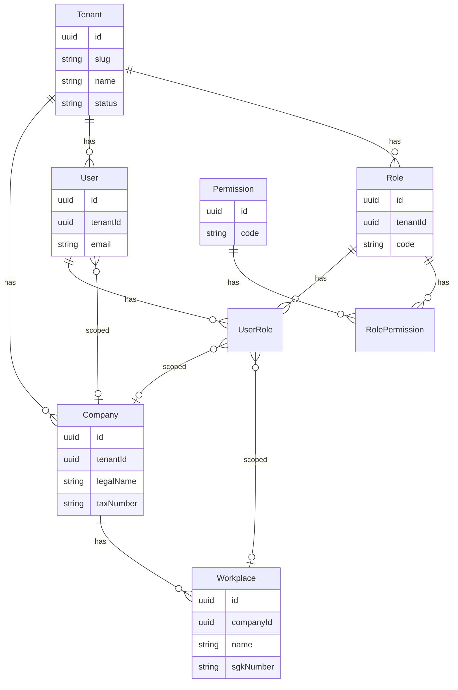
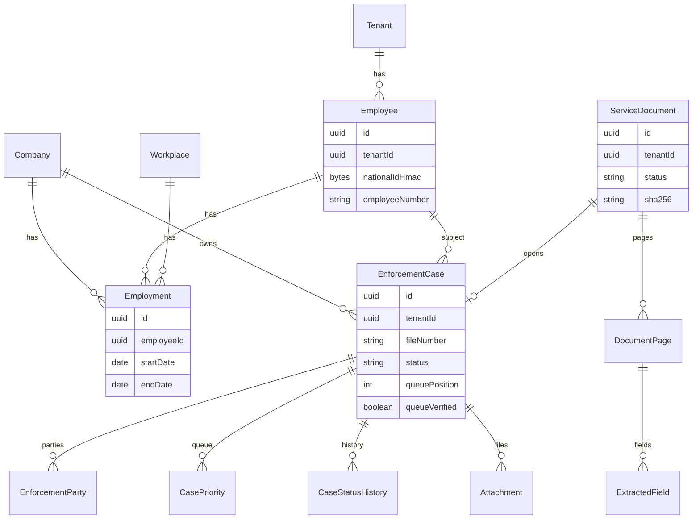
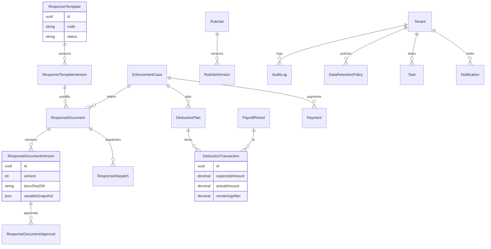

# Veri Modeli

**İlgili belgeler:** [requirements.md](./requirements.md) · [architecture.md](./architecture.md) · [workflows.md](./workflows.md)

Taslak Prisma şemasıdır; onay sonrası `packages/db` içine taşınır. Uygulama kodu bu belgeden üretilmeden önce U1–U20 ve hukuk maddeleri netleşmelidir.

---

## 1. Modelleme ilkeleri

1. **Her iş kaydında `tenantId`.** İstisna: `PlatformUser`, platform kural seti, Auth.js `VerificationToken` benzeri tablolar.
2. **Soft delete:** `deletedAt`. Unique kısıtlar kısmi index (`WHERE deleted_at IS NULL`).
3. **Optimistic concurrency:** değişen aggregate’lerde `version Int @default(1)`.
4. **Zaman:** `DateTime @db.Timestamptz` UTC. Salt tarih (bordro dönemi, işe giriş) `Date` (`@db.Date`).
5. **Para:** `Decimal @db.Decimal(19, 4)` saklama; gösterim 2 ondalık TRY. Ara hesap 4 basamak, kayıttan önce yuvarlama kuralı domain’de (banker's değil, `ROUND_HALF_UP` TR alışkanlığı — hukuk/muhasebe onayı).
6. **TCKN / IBAN:** `ciphertext` + `nonce` + `keyVersion`; arama için `nationalIdHmac` / `ibanHmac` (HMAC, pepper).
7. **ID:** `Uuid @id @default(dbgenerated("uuidv7()"))` veya uygulama UUID v7. Aşağıdaki taslakta `@default(uuid())` yer tutucu.
8. **Audit ayrı tablo.** İş satırına PII yazılmaz.
9. **Belge üzerine yazılmaz.** `ResponseDocumentVersion` yeni satır + yeni object key.

---

## 2. Bounded context’ler

```text
Identity        Tenant, Company, Workplace, User, Role, Permission
Workforce       Employee, Employment
Intake          ServiceDocument, DocumentPage, ExtractedField, Attachment
Enforcement     EnforcementCase, EnforcementParty, CasePriority, CaseStatusHistory
Templates       ResponseTemplate, ResponseTemplateVersion, TemplateCategory
Correspondence  ResponseDocument, Version, Approval, Dispatch
Payroll         PayrollPeriod, SalaryRecord, DeductionPlan, DeductionTransaction, Payment
Work            Task, Notification
Governance      RuleSet, RuleSetVersion, AuditLog, DataRetentionPolicy
```

---

## 3. ER — kimlik ve organizasyon



---

## 4. ER — personel, tebligat, icra



---

## 5. ER — şablon, cevap, kesinti, yönetişim



---

## 6. Prisma şema taslağı

Aşağıdaki taslak derlenebilir tam şema iddiası taşımaz; enum, index ve ilişki kararlarını dondurmak içindir. Onay sonrası `packages/db/prisma/schema.prisma` olarak parçalanabilir.

```prisma
generator client {
  provider        = "prisma-client-js"
  previewFeatures = ["postgresqlExtensions"]
}

datasource db {
  provider   = "postgresql"
  url        = env("DATABASE_URL")
  extensions = [pgcrypto]
}

// --- Enums ---

enum TenantStatus {
  ACTIVE
  SUSPENDED
  CLOSED
}

enum UserStatus {
  INVITED
  ACTIVE
  DISABLED
}

enum EmploymentStatus {
  ACTIVE
  TERMINATED
  NEVER_RECORDED
}

enum ServiceDocumentStatus {
  UPLOADED
  SCANNING
  SCAN_FAILED
  TEXT_EXTRACTING
  OCR_PENDING
  OCR_FAILED
  EXTRACTION_PENDING
  VALIDATION_PENDING
  VERIFIED
  REJECTED
}

enum EnforcementCaseStatus {
  OPEN
  AWAITING_MATCH
  AWAITING_QUEUE_VERIFICATION
  AWAITING_TEMPLATE
  QUEUED
  DEDUCTION_TO_START
  DEDUCTING
  EMPLOYEE_TERMINATED
  DEBT_COMPLETED
  CLOSED
  MANUAL_REVIEW
}

enum PartyRole {
  DEBTOR
  CREDITOR
  CREDITOR_REPRESENTATIVE
}

enum TemplateStatus {
  DRAFT
  PENDING_APPROVAL
  ACTIVE
  INACTIVE
  ARCHIVED
}

enum EditPolicy {
  LOCKED
  FIELDS_ONLY
  FULL_EDIT_WITH_APPROVAL
}

enum ResponseDocumentStatus {
  DRAFT
  AWAITING_APPROVAL
  APPROVED
  REJECTED
  DISPATCH_RECORDED
  SUPERSEDED
}

enum ApprovalDecision {
  APPROVED
  REJECTED
}

enum DeductionMethod {
  FIXED_AMOUNT
  RATE
}

enum DeductionTransactionType {
  EXPECTED
  ACTUAL
  ADJUSTMENT
  SKIPPED
}

enum PayrollPeriodStatus {
  OPEN
  LOCKED
}

enum TaskType {
  OCR_VALIDATION
  EMPLOYEE_MATCHING
  QUEUE_VERIFICATION
  TEMPLATE_SELECTION
  RESPONSE_APPROVAL
  DISPATCH_RECORDING
  MISSING_DEDUCTION
  VARIANCE_REVIEW
  DEBT_NEAR_ZERO
  DEBT_COMPLETED
  NEXT_CASE_ACTIVATION
  TERMINATION_WHILE_DEDUCTING
  RESPONSE_DEADLINE
  MANUAL_REVIEW
}

enum TaskStatus {
  OPEN
  IN_PROGRESS
  DONE
  CANCELLED
}

enum NotificationChannel {
  IN_APP
  EMAIL
  SMS
}

enum DataSource {
  USER_VERIFIED
  MASTER_DATA
  VERIFIED_CASE
  OCR_VERIFIED
  OCR_UNVERIFIED
  MANUAL_AT_GENERATION
}

enum FieldConfidenceBand {
  HIGH
  MEDIUM
  LOW
}

enum DispatchChannel {
  MANUAL_POST
  MANUAL_KEP
  MANUAL_EMAIL
  MANUAL_HAND
  OTHER
}

// --- Identity ---

model Tenant {
  id        String       @id @default(uuid())
  slug      String       @unique
  name      String
  status    TenantStatus @default(ACTIVE)
  settings  Json         @default("{}")
  createdAt DateTime     @default(now()) @db.Timestamptz
  updatedAt DateTime     @updatedAt @db.Timestamptz
  deletedAt DateTime?    @db.Timestamptz
  version   Int          @default(1)

  companies Company[]
  users     User[]
  roles     Role[]
}

model Company {
  id           String    @id @default(uuid())
  tenantId     String
  tenant       Tenant    @relation(fields: [tenantId], references: [id])
  legalName    String
  tradeName    String?
  taxNumber    String
  taxOffice    String?
  address      String?
  phone        String?
  email        String?
  signatoryDefaults Json @default("{}")
  createdAt    DateTime  @default(now()) @db.Timestamptz
  updatedAt    DateTime  @updatedAt @db.Timestamptz
  deletedAt    DateTime? @db.Timestamptz
  version      Int       @default(1)

  workplaces Workplace[]
  employments Employment[]
  cases      EnforcementCase[]

  @@unique([tenantId, taxNumber])
  @@index([tenantId])
}

model Workplace {
  id                 String    @id @default(uuid())
  tenantId           String
  companyId          String
  company            Company   @relation(fields: [companyId], references: [id])
  name               String
  address            String?
  registrationNumber String?
  sgkNumber          String?
  createdAt          DateTime  @default(now()) @db.Timestamptz
  updatedAt          DateTime  @updatedAt @db.Timestamptz
  deletedAt          DateTime? @db.Timestamptz
  version            Int       @default(1)

  employments Employment[]

  @@index([tenantId, companyId])
}

model User {
  id           String     @id @default(uuid())
  tenantId     String?
  tenant       Tenant?    @relation(fields: [tenantId], references: [id])
  email        String
  passwordHash String
  name         String
  status       UserStatus @default(INVITED)
  mfaEnabled   Boolean    @default(false)
  mfaSecretEnc Bytes?
  lastLoginAt  DateTime?  @db.Timestamptz
  createdAt    DateTime   @default(now()) @db.Timestamptz
  updatedAt    DateTime   @updatedAt @db.Timestamptz
  deletedAt    DateTime?  @db.Timestamptz
  version      Int        @default(1)

  roles    UserRole[]
  sessions Session[]

  @@unique([tenantId, email])
  @@index([email])
}

model Session {
  id        String   @id @default(uuid())
  userId    String
  user      User     @relation(fields: [userId], references: [id])
  expiresAt DateTime @db.Timestamptz
  createdAt DateTime @default(now()) @db.Timestamptz

  @@index([userId])
}

model Permission {
  id          String @id @default(uuid())
  code        String @unique
  description String
  roles       RolePermission[]
}

model Role {
  id          String   @id @default(uuid())
  tenantId    String?
  tenant      Tenant?  @relation(fields: [tenantId], references: [id])
  code        String
  name        String
  isSystem    Boolean  @default(false)
  createdAt   DateTime @default(now()) @db.Timestamptz
  updatedAt   DateTime @updatedAt @db.Timestamptz

  permissions RolePermission[]
  users       UserRole[]

  @@unique([tenantId, code])
}

model RolePermission {
  roleId       String
  permissionId String
  role         Role       @relation(fields: [roleId], references: [id])
  permission   Permission @relation(fields: [permissionId], references: [id])

  @@id([roleId, permissionId])
}

model UserRole {
  id          String     @id @default(uuid())
  userId      String
  roleId      String
  companyId   String?
  workplaceId String?
  user        User       @relation(fields: [userId], references: [id])
  role        Role       @relation(fields: [roleId], references: [id])
  createdAt   DateTime   @default(now()) @db.Timestamptz

  @@index([userId])
  @@index([roleId])
}

// --- Workforce ---

model Employee {
  id                 String    @id @default(uuid())
  tenantId           String
  employeeNumber     String?
  firstName          String
  lastName           String
  nationalIdEnc      Bytes
  nationalIdNonce    Bytes
  nationalIdHmac     Bytes
  keyVersion         Int       @default(1)
  createdAt          DateTime  @default(now()) @db.Timestamptz
  updatedAt          DateTime  @updatedAt @db.Timestamptz
  deletedAt          DateTime? @db.Timestamptz
  version            Int       @default(1)

  employments Employment[]
  cases       EnforcementCase[]

  @@unique([tenantId, nationalIdHmac])
  @@index([tenantId, lastName, firstName])
  @@index([tenantId, employeeNumber])
}

model Employment {
  id               String            @id @default(uuid())
  tenantId         String
  employeeId       String
  employee         Employee          @relation(fields: [employeeId], references: [id])
  companyId        String
  company          Company           @relation(fields: [companyId], references: [id])
  workplaceId      String?
  jobTitle         String?
  status           EmploymentStatus  @default(ACTIVE)
  startDate        Date              @db.Date
  endDate          Date?             @db.Date
  terminationCode  String?
  netSalary        Decimal?          @db.Decimal(19, 4)
  currency         String            @default("TRY")
  createdAt        DateTime          @default(now()) @db.Timestamptz
  updatedAt        DateTime          @updatedAt @db.Timestamptz
  deletedAt        DateTime?         @db.Timestamptz
  version          Int               @default(1)

  @@index([tenantId, employeeId])
  @@index([tenantId, companyId, status])
}

// --- Intake ---

model ServiceDocument {
  id               String                 @id @default(uuid())
  tenantId         String
  companyId        String
  workplaceId      String?
  status           ServiceDocumentStatus  @default(UPLOADED)
  originalFilename String
  contentType      String
  byteSize         Int
  sha256           String
  storageKey       String
  malwareStatus    String                 @default("PENDING")
  receivedDate     Date?                  @db.Date
  uploadedById     String
  createdAt        DateTime               @default(now()) @db.Timestamptz
  updatedAt        DateTime               @updatedAt @db.Timestamptz
  deletedAt        DateTime?              @db.Timestamptz
  version          Int                    @default(1)

  pages DocumentPage[]
  case  EnforcementCase?

  @@unique([tenantId, sha256])
  @@index([tenantId, status])
}

model DocumentPage {
  id             String          @id @default(uuid())
  tenantId       String
  documentId     String
  document       ServiceDocument @relation(fields: [documentId], references: [id])
  pageNumber     Int
  text           String
  ocrConfidence  Decimal?        @db.Decimal(5, 4)
  ocrProvider    String?
  imageStorageKey String?
  createdAt      DateTime        @default(now()) @db.Timestamptz

  fields ExtractedField[]

  @@unique([documentId, pageNumber])
  @@index([tenantId, documentId])
}

model ExtractedField {
  id            String              @id @default(uuid())
  tenantId      String
  pageId        String
  page          DocumentPage        @relation(fields: [pageId], references: [id])
  name          String
  rawValue      String
  normalizedValue String?
  confidence    Decimal             @db.Decimal(5, 4)
  band          FieldConfidenceBand
  sourceExcerpt String
  verified      Boolean             @default(false)
  verifiedById  String?
  verifiedAt    DateTime?           @db.Timestamptz
  verifiedValue String?
  extractor     String
  createdAt     DateTime            @default(now()) @db.Timestamptz
  updatedAt     DateTime            @updatedAt @db.Timestamptz

  @@index([tenantId, pageId])
}

model Attachment {
  id           String   @id @default(uuid())
  tenantId     String
  companyId    String
  caseId       String?
  paymentId    String?
  kind         String
  filename     String
  contentType  String
  byteSize     Int
  sha256       String
  storageKey   String
  uploadedById String
  createdAt    DateTime @default(now()) @db.Timestamptz

  @@index([tenantId, caseId])
}

// --- Enforcement ---

model EnforcementCase {
  id                         String                 @id @default(uuid())
  tenantId                   String
  companyId                  String
  company                    Company                @relation(fields: [companyId], references: [id])
  workplaceId                String?
  employeeId                 String?
  employee                   Employee?              @relation(fields: [employeeId], references: [id])
  serviceDocumentId          String?                @unique
  serviceDocument            ServiceDocument?       @relation(fields: [serviceDocumentId], references: [id])
  status                     EnforcementCaseStatus  @default(OPEN)
  enforcementOffice          String?
  fileNumber                 String?
  noticeType                 String?
  serviceDate                Date?                  @db.Date
  receivedDate               Date?                  @db.Date
  responseDeadline           Date?                  @db.Date
  principalDebt              Decimal?               @db.Decimal(19, 4)
  interest                   Decimal?               @db.Decimal(19, 4)
  expenses                   Decimal?               @db.Decimal(19, 4)
  totalDebt                  Decimal?               @db.Decimal(19, 4)
  remainingDebt              Decimal?               @db.Decimal(19, 4)
  remainingDebtOverride      Decimal?               @db.Decimal(19, 4)
  remainingDebtOverrideReason String?
  currency                   String                 @default("TRY")
  requestedDeductionRate     Decimal?               @db.Decimal(7, 4)
  requestedDeductionAmount   Decimal?               @db.Decimal(19, 4)
  paymentBank                String?
  paymentIbanEnc             Bytes?
  paymentIbanNonce           Bytes?
  paymentIbanHmac            Bytes?
  paymentReference           String?
  queuePosition              Int?
  queueVerified              Boolean                @default(false)
  queueVerifiedById          String?
  queueVerifiedAt            DateTime?              @db.Timestamptz
  queueRuleSetVersionId      String?
  queueReason                String?
  deductionStartDate         Date?                  @db.Date
  deductionEndDate           Date?                  @db.Date
  totalDeducted              Decimal                @default(0) @db.Decimal(19, 4)
  notes                      String?
  createdAt                  DateTime               @default(now()) @db.Timestamptz
  updatedAt                  DateTime               @updatedAt @db.Timestamptz
  deletedAt                  DateTime?              @db.Timestamptz
  version                    Int                    @default(1)

  parties     EnforcementParty[]
  priorities  CasePriority[]
  history     CaseStatusHistory[]
  responses   ResponseDocument[]
  plans       DeductionPlan[]
  deductions  DeductionTransaction[]
  payments    Payment[]

  @@unique([tenantId, enforcementOffice, fileNumber])
  @@index([tenantId, status])
  @@index([tenantId, employeeId])
  @@index([tenantId, companyId])
  @@index([tenantId, responseDeadline])
}

model EnforcementParty {
  id        String    @id @default(uuid())
  tenantId  String
  caseId    String
  case      EnforcementCase @relation(fields: [caseId], references: [id])
  role      PartyRole
  name      String
  extra     Json      @default("{}")
  createdAt DateTime  @default(now()) @db.Timestamptz

  @@index([tenantId, caseId])
}

model CasePriority {
  id                 String          @id @default(uuid())
  tenantId           String
  caseId             String
  case               EnforcementCase @relation(fields: [caseId], references: [id])
  position           Int
  proposedPosition   Int
  verified           Boolean         @default(false)
  reason             String
  changeReason       String?
  ruleSetVersionId   String
  changedById        String?
  createdAt          DateTime        @default(now()) @db.Timestamptz

  @@index([tenantId, caseId])
}

model CaseStatusHistory {
  id         String                 @id @default(uuid())
  tenantId   String
  caseId     String
  case       EnforcementCase        @relation(fields: [caseId], references: [id])
  fromStatus EnforcementCaseStatus?
  toStatus   EnforcementCaseStatus
  reason     String?
  actorId    String?
  createdAt  DateTime               @default(now()) @db.Timestamptz

  @@index([tenantId, caseId, createdAt])
}

// --- Templates ---

model TemplateCategory {
  id        String   @id @default(uuid())
  tenantId  String?
  code      String
  name      String
  createdAt DateTime @default(now()) @db.Timestamptz

  @@unique([tenantId, code])
}

model ResponseTemplate {
  id          String         @id @default(uuid())
  tenantId    String?
  categoryId  String?
  code        String
  name        String
  description String?
  status      TemplateStatus @default(DRAFT)
  createdAt   DateTime       @default(now()) @db.Timestamptz
  updatedAt   DateTime       @updatedAt @db.Timestamptz
  deletedAt   DateTime?      @db.Timestamptz
  version     Int            @default(1)

  versions ResponseTemplateVersion[]
  scopes   TemplateScope[]

  @@unique([tenantId, code])
}

model TemplateScope {
  id          String @id @default(uuid())
  templateId  String
  template    ResponseTemplate @relation(fields: [templateId], references: [id])
  tenantId    String?
  companyId   String?
  workplaceId String?
}

model ResponseTemplateVersion {
  id                   String         @id @default(uuid())
  templateId           String
  template             ResponseTemplate @relation(fields: [templateId], references: [id])
  versionNumber        Int
  storageKey           String
  sha256               String
  status               TemplateStatus @default(DRAFT)
  editPolicy           EditPolicy     @default(LOCKED)
  requiredVariables    String[]
  optionalVariables    String[]
  extractedVariables   String[]
  unknownVariables     String[]
  recommendationMatcher Json          @default("{}")
  validFrom            DateTime?      @db.Timestamptz
  validTo              DateTime?      @db.Timestamptz
  createdById          String
  approvedById         String?
  approvedAt           DateTime?      @db.Timestamptz
  createdAt            DateTime       @default(now()) @db.Timestamptz

  documents ResponseDocument[]

  @@unique([templateId, versionNumber])
}

// --- Correspondence ---

model ResponseDocument {
  id                     String                 @id @default(uuid())
  tenantId               String
  caseId                 String
  case                   EnforcementCase        @relation(fields: [caseId], references: [id])
  templateVersionId      String
  templateVersion        ResponseTemplateVersion @relation(fields: [templateVersionId], references: [id])
  status                 ResponseDocumentStatus @default(DRAFT)
  selectionReason        String?
  selectedById           String
  createdAt              DateTime               @default(now()) @db.Timestamptz
  updatedAt              DateTime               @updatedAt @db.Timestamptz
  deletedAt              DateTime?              @db.Timestamptz
  version                Int                    @default(1)

  versions  ResponseDocumentVersion[]
  approvals ResponseDocumentApproval[]
  dispatches ResponseDispatch[]

  @@index([tenantId, caseId])
  @@index([tenantId, status])
}

model ResponseDocumentVersion {
  id                 String           @id @default(uuid())
  tenantId           String
  documentId         String
  document           ResponseDocument @relation(fields: [documentId], references: [id])
  versionNumber      Int
  variableSnapshot   Json
  sourceSnapshot     Json
  manualEdits        Json?
  docxStorageKey     String?
  pdfStorageKey      String?
  docxSha256         String?
  pdfSha256          String?
  createdById        String
  createdAt          DateTime         @default(now()) @db.Timestamptz

  @@unique([documentId, versionNumber])
}

model ResponseDocumentApproval {
  id           String           @id @default(uuid())
  tenantId     String
  documentId   String
  document     ResponseDocument @relation(fields: [documentId], references: [id])
  decision     ApprovalDecision
  comment      String?
  decidedById  String
  decidedAt    DateTime         @default(now()) @db.Timestamptz
}

model ResponseDispatch {
  id            String          @id @default(uuid())
  tenantId      String
  documentId    String
  document      ResponseDocument @relation(fields: [documentId], references: [id])
  channel       DispatchChannel
  dispatchedAt  DateTime        @db.Timestamptz
  trackingRef   String?
  notes         String?
  recordedById  String
  createdAt     DateTime        @default(now()) @db.Timestamptz
}

// --- Payroll ---

model PayrollPeriod {
  id        String              @id @default(uuid())
  tenantId  String
  companyId String
  year      Int
  month     Int
  status    PayrollPeriodStatus @default(OPEN)
  lockedAt  DateTime?           @db.Timestamptz
  lockedById String?
  createdAt DateTime            @default(now()) @db.Timestamptz
  updatedAt DateTime            @updatedAt @db.Timestamptz
  version   Int                 @default(1)

  salaries    SalaryRecord[]
  deductions  DeductionTransaction[]

  @@unique([tenantId, companyId, year, month])
}

model SalaryRecord {
  id              String        @id @default(uuid())
  tenantId        String
  periodId        String
  period          PayrollPeriod @relation(fields: [periodId], references: [id])
  employeeId      String
  employmentId    String?
  netSalary       Decimal       @db.Decimal(19, 4)
  garnishmentBase Decimal       @db.Decimal(19, 4)
  currency        String        @default("TRY")
  source          String
  importKey       String
  createdAt       DateTime      @default(now()) @db.Timestamptz

  @@unique([tenantId, importKey])
  @@index([tenantId, employeeId, periodId])
}

model DeductionPlan {
  id            String          @id @default(uuid())
  tenantId      String
  caseId        String
  case          EnforcementCase @relation(fields: [caseId], references: [id])
  method        DeductionMethod
  rate          Decimal?        @db.Decimal(7, 4)
  amount        Decimal?        @db.Decimal(19, 4)
  startPeriodId String?
  active        Boolean         @default(true)
  createdAt     DateTime        @default(now()) @db.Timestamptz
  updatedAt     DateTime        @updatedAt @db.Timestamptz
  version       Int             @default(1)

  transactions DeductionTransaction[]
}

model DeductionTransaction {
  id                 String                   @id @default(uuid())
  tenantId           String
  caseId             String
  case               EnforcementCase          @relation(fields: [caseId], references: [id])
  planId             String?
  plan               DeductionPlan?           @relation(fields: [planId], references: [id])
  periodId           String
  period             PayrollPeriod            @relation(fields: [periodId], references: [id])
  type               DeductionTransactionType
  expectedAmount     Decimal                  @db.Decimal(19, 4)
  actualAmount       Decimal?                 @db.Decimal(19, 4)
  variance           Decimal?                 @db.Decimal(19, 4)
  remainingAfter     Decimal?                 @db.Decimal(19, 4)
  skipReason         String?
  adjustmentReason   String?
  importKey          String
  createdById        String
  createdAt          DateTime                 @default(now()) @db.Timestamptz
  updatedAt          DateTime                 @updatedAt @db.Timestamptz
  version            Int                      @default(1)

  @@unique([tenantId, importKey])
  @@index([tenantId, caseId, periodId])
}

model Payment {
  id            String          @id @default(uuid())
  tenantId      String
  caseId        String
  case          EnforcementCase @relation(fields: [caseId], references: [id])
  amount        Decimal         @db.Decimal(19, 4)
  paidAt        Date            @db.Date
  bankName      String?
  ibanHmac      Bytes?
  reference     String?
  receiptKey    String?
  createdById   String
  createdAt     DateTime        @default(now()) @db.Timestamptz

  @@index([tenantId, caseId])
}

// --- Work ---

model Task {
  id          String     @id @default(uuid())
  tenantId    String
  type        TaskType
  status      TaskStatus @default(OPEN)
  dueAt       DateTime?  @db.Timestamptz
  caseId      String?
  documentId  String?
  assigneeId  String?
  payload     Json       @default("{}")
  createdAt   DateTime   @default(now()) @db.Timestamptz
  updatedAt   DateTime   @updatedAt @db.Timestamptz

  @@index([tenantId, status, dueAt])
  @@index([tenantId, type])
}

model Notification {
  id        String              @id @default(uuid())
  tenantId  String
  userId    String
  channel   NotificationChannel
  title     String
  body      String
  readAt    DateTime?           @db.Timestamptz
  taskId    String?
  createdAt DateTime            @default(now()) @db.Timestamptz

  @@index([tenantId, userId, readAt])
}

// --- Governance ---

model RuleSet {
  id        String   @id @default(uuid())
  tenantId  String?
  code      String
  name      String
  createdAt DateTime @default(now()) @db.Timestamptz

  versions RuleSetVersion[]

  @@unique([tenantId, code])
}

model RuleSetVersion {
  id          String    @id @default(uuid())
  ruleSetId   String
  ruleSet     RuleSet   @relation(fields: [ruleSetId], references: [id])
  version     Int
  validFrom   DateTime  @db.Timestamptz
  validTo     DateTime? @db.Timestamptz
  body        Json
  approvedById String?
  createdAt   DateTime  @default(now()) @db.Timestamptz

  @@unique([ruleSetId, version])
}

model AuditLog {
  id           String   @id @default(uuid())
  tenantId     String?
  actorId      String?
  action       String
  entityType   String
  entityId     String?
  ip           String?
  userAgent    String?
  beforeDigest String?
  afterDigest  String?
  metadata     Json     @default("{}")
  createdAt    DateTime @default(now()) @db.Timestamptz

  @@index([tenantId, createdAt])
  @@index([tenantId, entityType, entityId])
  @@index([actorId, createdAt])
}

model DataRetentionPolicy {
  id            String   @id @default(uuid())
  tenantId      String
  entityType    String
  retainForDays Int
  action        String
  legalHold     Boolean  @default(false)
  createdAt     DateTime @default(now()) @db.Timestamptz
  updatedAt     DateTime @updatedAt @db.Timestamptz

  @@unique([tenantId, entityType])
}

model ImportJob {
  id           String   @id @default(uuid())
  tenantId     String
  kind         String
  status       String
  totalRows    Int      @default(0)
  successRows  Int      @default(0)
  failedRows   Int      @default(0)
  reportKey    String?
  createdById  String
  createdAt    DateTime @default(now()) @db.Timestamptz
}
```

Auth.js tabloları (`Account`, `VerificationToken`) ayrı tutulur; `User` ile birleştirme onay sonrası yapılır.

---

## 7. Unique, index, RLS notları

| Konu | Karar |
| --- | --- |
| Dosya numarası | `(tenantId, enforcementOffice, fileNumber)` unique; müdürlük boşken geçici `PENDING-{uuid}` |
| Hash tekrarı | Aynı SHA-256 tenant içinde ikinci yüklemede uyarı; zorla devam gerekçeli |
| TCKN | Unique HMAC; silinmiş kayıt kısmi index ile aynı TCKN’nin yeniden açılmasına izin (politika onayı) |
| Import | `importKey` = `sha256(tenantId + kind + naturalKey)` |
| RLS | Bütün `tenantId` kolonlu tablolarda `USING (tenant_id = current_setting('app.tenant_id')::uuid)` |
| Platform satırlar | `tenantId` null şablon/kural: RLS `tenant_id IS NULL OR tenant_id = current_setting(...)` yalnızca okuma; yazma platform rolü |
| Çok kolonlu liste | `tenantId + status + updatedAt DESC` |

`EnforcementCase.fileNumber` boşken unique ihlali olmasın diye yükleme anında geçici numara veya `serviceDocumentId` temelli yer tutucu kullanılır. Karar: U4 ile birlikte.

---

## 8. Kalan borç

```
remainingDebt = remainingDebtOverride
  ?? max(totalDebt - sum(actual deductions and payments), 0)
```

Override gerekçe + audit zorunlu. `totalDebt` değişince override yoksa yeniden hesap. Negatif kalan yazılmaz; fazla kesinti `variance` olarak kalır, hukuk/bordro kararı bekler.

---

## 9. Seed kısıtları

- Gerçek TCKN algoritmasını geçen **sahte** numaralar (üretim checksum, gerçek kişi değil).
- IBAN: TR checksum geçerli sahte.
- İsimler açıkça kurgusal (`Örnek Personel`).
- Şablon seed: boş antetli DOCX, gerçek şirket anteti değil.

---

## 10. Göç riski

İlk migration’dan itibaren RLS politikaları açık olmalıdır. “Önce şema sonra RLS” penceresi staging’de bile IDOR üretir.

Şema evrimi: TCKN şifreleme anahtarı rotasyonu `keyVersion` ile; eski satırlar background job.

Bu taslak onaylanmadan `prisma migrate` çalıştırılmamalıdır.
