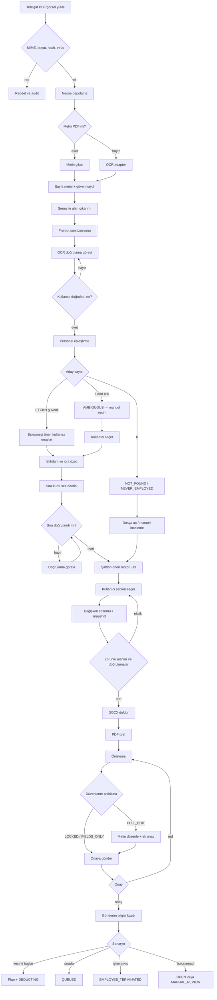
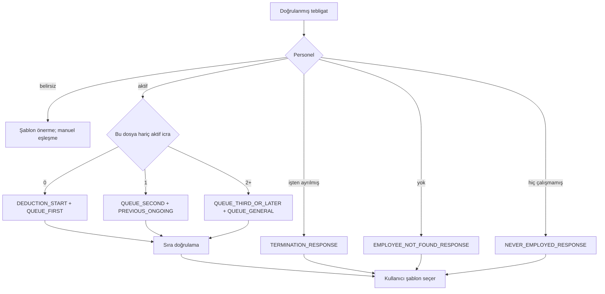
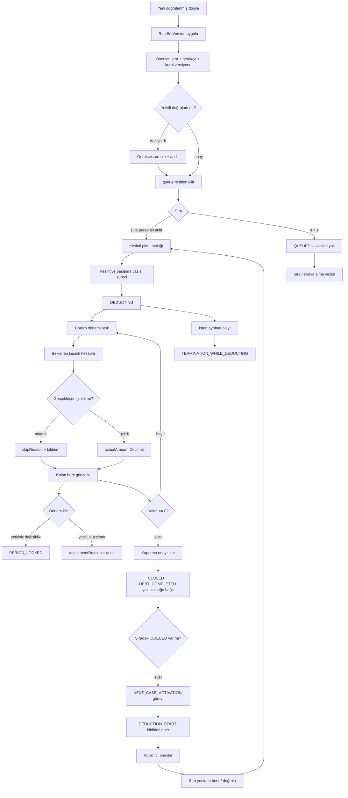
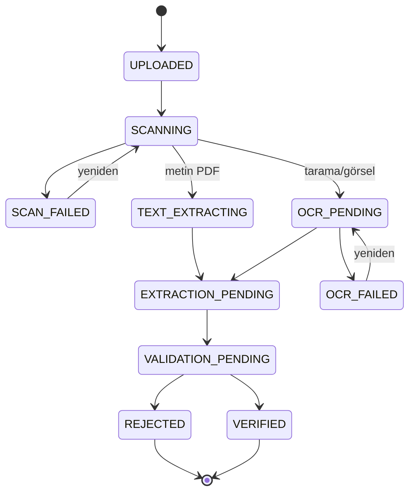
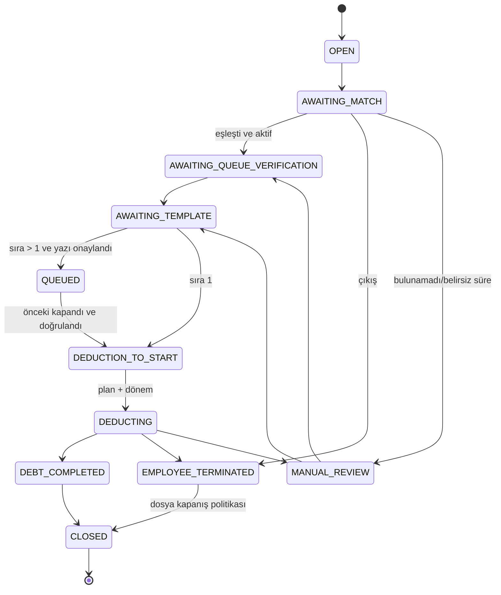
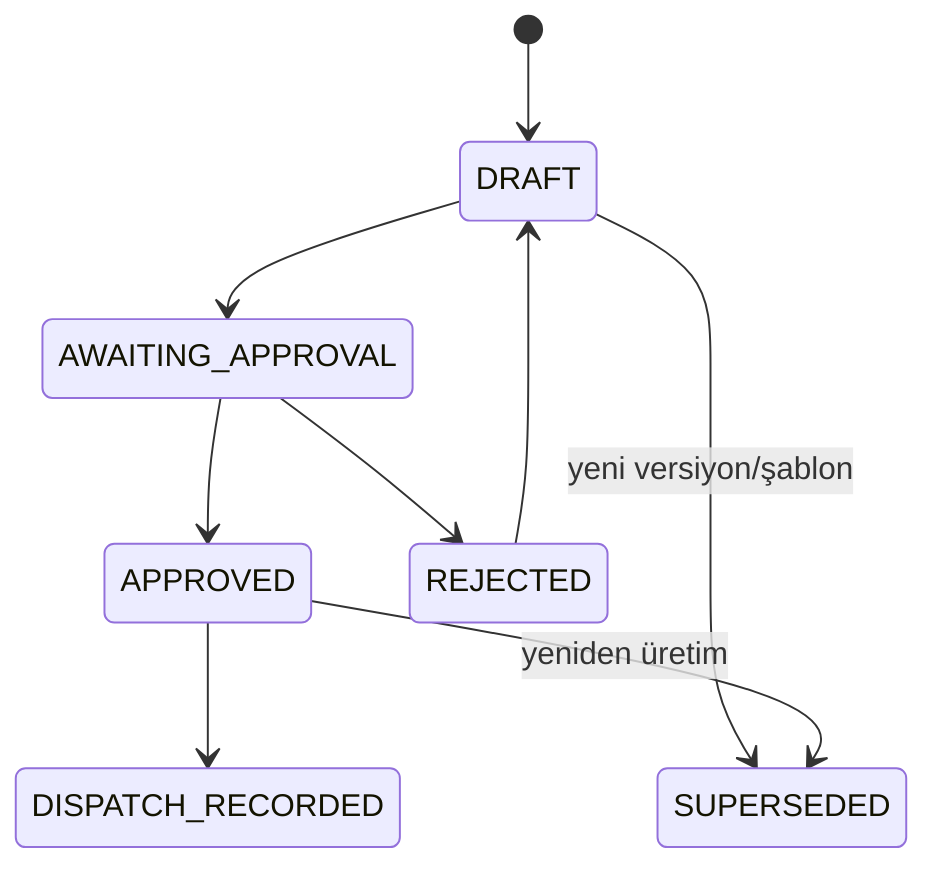

# İş Akışları ve Durum Geçişleri

**İlgili belgeler:** [requirements.md](./requirements.md) · [template-engine.md](./template-engine.md) · [data-model.md](./data-model.md)

Bu belgedeki hesaplar **öneridir**. Ekranda kesin hukuki karar gibi gösterilmez.

---

## 1. Ana iş akışı (tebligattan gönderim kaydına)



Onaysız otomatik e-posta/KEP yok.

---

## 2. Senaryo haritası



---

## 3. İcra sırası ve kesinti akışı



Sıra değişikliği her zaman audit. Doğrulanmamış sıra ile nihai yazı yok.

---

## 4. Kuyruk hesabı (v1 politika — hukuk onayı bekler)

Bu fonksiyon seed `RuleSetVersion` gövdesidir; İİK iddiası değildir.

**Girdi:** personelin aynı şirketteki dosyaları (varsayılan şirket kapsamı).

**Aday “aktif öncelik”:** durum `DEDUCTING` veya `DEDUCTION_TO_START`; `CLOSED` / `DEBT_COMPLETED` / `EMPLOYEE_TERMINATED` hariç.

**Öneri:**

```
proposedPosition = count(activePriorityCases) + 1
```

Sıralama anahtarı (belirsiz, U1 hukuk): `receivedDate ASC`, eşitlikte `createdAt ASC`. Nafaka/kamu istisnası **kapalı** bayrak.

**Çıktı:** `{ proposedPosition, activeCaseIds, ruleSetVersionId, explanation }`.

`explanation` örneği: “Doğrulanmış 1 aktif kesinti dosyası var; yeni dosya 2. sıra olarak önerildi (kural v3).”

Personel `TERMINATED` / `NOT_FOUND` / `NEVER_EMPLOYED` ise `calculatedQueuePosition = null`.

---

## 5. Üç durum makinesi

Ürün listesindeki tek “dosya durumu” UI aşamasına map edilir.

### 5.1 ServiceDocument



### 5.2 EnforcementCase



Geçişler domain’de tablo; rastgele `PATCH status` yok.

### 5.3 ResponseDocument



Nihai indirme: `APPROVED` veya `DISPATCH_RECORDED`. Taslak indirme filigranlı ve ayrı izin.

---

## 6. Ürün durumu → dahili durum eşlemesi

| Ürün etiketi (TR) | Asıl kaynak |
| --- | --- |
| Yeni tebligat | Document `UPLOADED` |
| OCR bekliyor | Document `OCR_PENDING` / `TEXT_EXTRACTING` |
| Veri doğrulama bekliyor | Document `VALIDATION_PENDING` |
| Personel eşleştirme bekliyor | Case `AWAITING_MATCH` |
| Şablon seçimi bekliyor | Case `AWAITING_TEMPLATE` |
| Cevap yazısı hazırlanıyor | Response `DRAFT` |
| Onay bekliyor | Response `AWAITING_APPROVAL` |
| Gönderim bekliyor | Response `APPROVED` ve dispatch yok |
| Kesinti başlayacak | Case `DEDUCTION_TO_START` |
| Kesinti devam ediyor | Case `DEDUCTING` |
| Sırada bekliyor | Case `QUEUED` |
| Personel işten ayrılmış | Case `EMPLOYEE_TERMINATED` |
| Borç tamamlandı | Case `DEBT_COMPLETED` |
| Dosya kapandı | Case `CLOSED` |
| Manuel incelemede | Case `MANUAL_REVIEW` |

Dashboard ve liste “aşama” bu eşlemeden türetilir.

---

## 7. Geçiş korumaları

| Geçiş | Koruma |
| --- | --- |
| Document → VERIFIED | Zorunlu alanlar verified; düşük güven ya onaylı ya boş bırakılıp manuel |
| Match otomatik | Tek aday **ve** TCKN HMAC eşleşmesi **ve** OCR TCKN verified |
| Case → AWAITING_TEMPLATE | Personel çözüldü (veya NOT_FOUND yolu) |
| Nihai render | Document VERIFIED; ilgiliyse `queueVerified`; required variables |
| Case → DEDUCTING | Onaylı cevap (tenant politikası) + plan + sıra 1 |
| Case → CLOSED | Kullanıcı onayı; remainingDebt 0 veya gerekçeli istisna |
| QUEUED → DEDUCTION_TO_START | Önceki CLOSED; yeni sıra doğrulaması; görev kapanışı |
| Period lock | `payroll:lock`; unlock ayrı izin |
| Kilitli dönem satır düzeltme | unlock veya yetkili adjustment + reason |

---

## 8. Görev üretimi

| Tetik | TaskType | Süre |
| --- | --- | --- |
| Çıkarım bitti | `OCR_VALIDATION` | hemen |
| Doğrulandı, eşleşme yok/çok | `EMPLOYEE_MATCHING` | hemen |
| Eşleşme aktif personel | `QUEUE_VERIFICATION` | hemen |
| Sıra doğrulandı | `TEMPLATE_SELECTION` | hemen |
| Render + politika | `RESPONSE_APPROVAL` | hemen |
| Cevap onaylandı | `DISPATCH_RECORDING` | hemen |
| `responseDeadline` - N gün | `RESPONSE_DEADLINE` | SLA tarayıcı |
| Dönem kapanmadan kesinti yok | `MISSING_DEDUCTION` | SLA |
| `variance != 0` | `VARIANCE_REVIEW` | eşik tenant ayarı |
| remainingDebt ≤ eşik | `DEBT_NEAR_ZERO` | |
| remainingDebt = 0 | `DEBT_COMPLETED` | |
| Case CLOSED + next queued | `NEXT_CASE_ACTIVATION` | transaction içi |
| Employment endDate + DEDUCTING | `TERMINATION_WHILE_DEDUCTING` | |

Bildirim: in-app zorunlu; e-posta/SMS adapter tenant ayarı.

---

## 9. Kesinti matematiği

```
expected = method == RATE
  ? round(garnishmentBase * rate, 2, HALF_UP)
  : fixedAmount

variance = actual - expected
totalDeducted += actual
remaining = override ?? max(totalDebt - totalDeducted - payments, 0)
```

`number` yok. `garnishmentBase` yoksa net ücret **otomatik kullanılmaz**; kullanıcı veya import doldurur (U9).

Idempotent import: `importKey` unique. Aynı dosya tekrar: success=0, duplicate sayacı, yeni kesinti yok.

---

## 10. Dosya kapanınca sıradaki

Tek transaction:

1. Case A → `DEBT_COMPLETED` / `CLOSED`
2. Audit
3. Personelin `QUEUED` dosyalarını `position ASC` oku
4. B için `NEXT_CASE_ACTIVATION` (yoksa oluştur — idempotent)
5. Bildirim
6. Şablon önerisi hesaplanır ama **otomatik seçilmez, otomatik kesinti başlamaz**

---

## 11. UI notları (akışa bağlı)

- OCR: belge sol, alanlar sağ; seçilen alan `sourcePage` + excerpt highlight.
- Tarih: `DD.MM.YYYY` (İstanbul).
- Para: `tr-TR`.
- TCKN/IBAN maskeli; `sensitive:read` + açık göster tıklaması audit.
- Kritik süre, eksik veri, gecikme rozetleri listelerde zorunlu.
